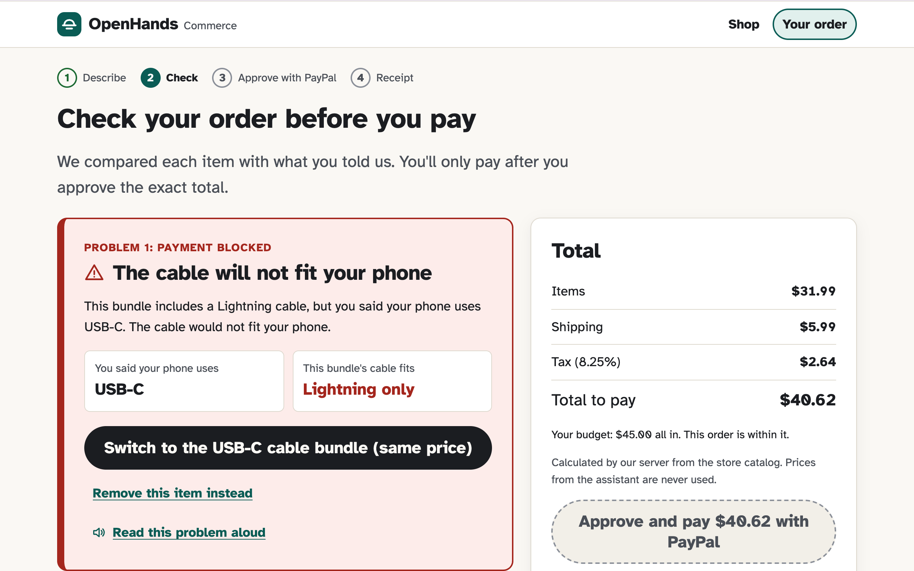

# OpenHands Commerce

**The accessible shopping assistant that catches a purchase mistake before you pay, explains it, and fixes it in one step — then pays with PayPal.**

Built for the PayPal AI Hackathon 2026. Fictional demo store · **PayPal Sandbox only — no real money** · Apache-2.0.



## What it does

1. Describe what you need in your own words (type, paste or speak). The assistant shows what it understood as an editable "Shopping for" card.
2. Get up to three options from the store catalog, each reason citing its source, plus a side-by-side comparison.
3. Before PayPal opens, the server checks your order against what you said — connector fit, voice language, stock, price changes and your all-in budget. A problem blocks payment, is explained in plain language (announced by screen readers), and has a one-step fix.
4. Approve the exact server-calculated total with PayPal (Orders v2, sandbox). We capture once and show a receipt only when PayPal confirms the capture `COMPLETED` for that amount.

**The AI explains, the server decides, you approve.** Claude helps understand requests and phrase explanations; it has no tools, cannot reach payment code, and every sentence it writes is validated. Without an API key the app runs on its rule-based fallback and says so.

## Try it

**Hosted demo:** [hosted demo URL: pending]

**Run it yourself (about 10 minutes).** You need Node 20.9 or later and your own free PayPal Sandbox app (test money only). Claude is optional.

```sh
git clone https://github.com/mogohary99/openhands-commerce.git
cd openhands-commerce/web
npm ci
cp .env.example .env.local   # add your PayPal *sandbox* Client ID and Secret; ANTHROPIC_API_KEY optional
npm run dev                  # http://localhost:3000
```

Then click the first example, "My phone uses USB-C. I need a charger with a cable, forty-five dollars all in.", pick the Lightning cable bundle and watch payment get blocked. Step-by-step setup, the demo script, tests and troubleshooting: [`web/README.md` → For judges](web/README.md#for-judges).

**Evidence of a real sandbox purchase:** order `6DB70558VY7613132`, capture `0X564302AP931181C`, `COMPLETED`, 40.62 USD, confirmed by PayPal's own API ([`docs/evidence/sandbox-purchase-manual-buyer.json`](docs/evidence/sandbox-purchase-manual-buyer.json), [`docs/qa-report.md`](docs/qa-report.md) §3a).

## Docs

| | |
|---|---|
| QA evidence (what was tested, how, and what wasn't) | [`docs/qa-report.md`](docs/qa-report.md) |
| Architecture | [`docs/architecture.md`](docs/architecture.md) |
| Deployment (prepared, not deployed) | [`docs/deployment.md`](docs/deployment.md) |
| Devpost draft, video script, usability-testing script | [`docs/submission/`](docs/submission/) |
| Research (PayPal feasibility, accessibility, landscape, verified rules) | [`research/`](research/) |
| Early technical spikes | [`spikes/`](spikes/) |

## Honest limits

- The OpenHands Demo Store and its products, prices and reviews are fictional demo data. OpenHands does not shop at arbitrary merchants.
- Payments are PayPal Sandbox only; the code cannot reach live PayPal.
- Accessibility is checked automatically (axe, keyboard, accessibility tree, zoom, contrast modes). VoiceOver on macOS was run by the developer's AI assistant (Claude), not by blind or low-vision users. No sessions with disabled users have happened yet. NVDA, JAWS and TalkBack were not tested. No WCAG conformance or certification is claimed.
